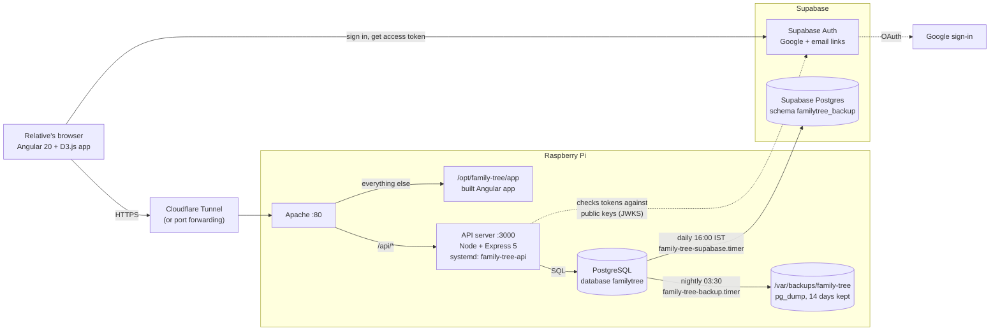

# Kudumbam — API server

The API behind **Kudumbam**, a family tree that relatives build together. Each family's tree is private to the
people invited to it. Express 5 + PostgreSQL, written in TypeScript that Node runs directly (no build step).
Supabase is used **only for sign-in**: the API checks Supabase access tokens against the project's public keys and
needs no Supabase secret.

The web app (Angular + D3) is a separate project that talks to this API under `/api`.

## Architecture

This repository is the **API server** box below. The web app, the Raspberry Pi set-up and the backup scripts live in
[kudumbam-web](https://github.com/pbrajesh/kudumbam-web).



- The browser signs in with Supabase Auth (Google or an email link) and sends the access token as
  `Authorization: Bearer …`. This server checks it against the project's public keys (`src/auth.ts`); it needs no
  Supabase secret.
- On the Pi, Apache serves the built web app and passes `/api/*` to this server on `127.0.0.1:3000`
  (systemd service `family-tree-api`). The server only talks to the local PostgreSQL; family data never goes to
  Supabase except the backup copy.
- Backups (kudumbam-web, `deploy/raspberry-pi/`): a nightly `pg_dump` at 03:30 kept for 14 days on the Pi, and a daily
  16:00 IST copy into the private `familytree_backup` schema of the Supabase Postgres.

## Requirements

- Node **22.18+** (runs the `.ts` files directly)
- PostgreSQL **15+** — or, for development, the embedded PGlite (`npm run db:dev`, nothing to install)
- A Supabase project with email (and optionally Google) sign-in

## Run it locally

```bash
npm install
cp .env.example .env        # set SUPABASE_URL
npm run db:dev              # terminal 1: local PostgreSQL (PGlite) on port 54329, data in .pgdata/
npm start                   # terminal 2: API on http://localhost:3000
```

Tables are created and updated on start from the numbered files in `migrations/` (never edit one that has been
applied; add a new file). Check: `curl http://localhost:3000/api/health` → `{"ok":true}`.

## Settings (`.env`)

| Variable | Meaning |
|---|---|
| `DATABASE_URL` | PostgreSQL connection string |
| `PG_POOL_MAX` | Connection pool size. `1` with `db:dev` (PGlite is a single session); leave unset for real PostgreSQL |
| `SUPABASE_URL` | Your Supabase project URL — tokens are checked against `<SUPABASE_URL>/auth/v1/.well-known/jwks.json` |
| `CORS_ORIGINS` | Comma-separated web app origins if the app is served from another domain; empty when same-origin |
| `TRUST_PROXY` | Proxies in front of the API (e.g. `1` behind Apache/nginx, `2` behind Cloudflare Tunnel + Apache), so rate limits see each visitor's IP |
| `PORT` | Default 3000 |
| `MAX_TREES_PER_USER`, `MAX_MEMBERS_PER_TREE`, `MAX_PEOPLE_PER_TREE` | Limits (defaults 5, 200, 20000) |

## API

All routes except `/api/health` need `Authorization: Bearer <Supabase access token>`.

| Route | Who |
|---|---|
| `GET /api/health` | anyone |
| `GET /api/me` · `DELETE /api/me?confirm=<email>` | signed in: your trees · delete everything stored about you |
| `POST /api/trees` | signed in: start a tree (you become its owner) |
| `GET` · `PATCH` · `DELETE /api/trees/:treeId` | viewer · editor (name: owner) · owner (`?confirm=<exact name>`) |
| `GET /api/trees/:treeId/tree` | viewer: the whole tree with record versions |
| `POST /api/trees/:treeId/changes` | editor: one edit, any number of records, one transaction |
| `POST /api/trees/:treeId/import` | editor: replace the tree with an imported file |
| `…/people`, `…/families`, `…/families/:id/children`, `…/families/:id/spouses` | editor: per-record REST routes |
| `GET` · `POST` · `PATCH` · `DELETE /api/trees/:treeId/members…` | viewer · owner · owner · owner; `DELETE …/members/me` = leave |
| `PUT` · `DELETE …/members/me/claim` · `DELETE …/members/me/person` | viewer: "This is me" on a person (owners are linked at once) · take the claim back · unlink yourself |
| `PUT` · `DELETE …/members/:email/person` · `DELETE …/members/:email/claim` | owner: link a member to a person (approves their claim) · unlink · turn a claim down |

- **Isolation:** every query is limited to the tree in the URL; a tree you are not a member of answers **404**, like
  one that does not exist. Composite foreign keys stop records linking across trees.
- **Concurrency:** every person and family carries a `version`; a stale write answers **409** and changes nothing.
- **Roles:** viewer < editor < owner. A tree always keeps at least one owner.
- **Who you are:** each membership can be linked to one person in that tree, and each person to one member.
  `GET …/tree` and `GET /api/trees/:treeId` include `you: { personId, claimedPersonId }` and, for owners,
  `pendingClaims`. Deleting the person or importing a new file clears the link.
- **Rate limits** (429): per IP for all requests, per user for changes, new trees and added members (`src/limits.ts`).

## Command-line tools

```bash
npm run member -- trees
npm run member -- create-tree "The Example family" owner@example.com
npm run member -- add someone@example.com editor [--tree <id or name>]
npm run member -- remove someone@example.com [--tree <id or name>]
npm run member -- list [--tree <id or name>]
npm run backup                 # every table to ../data/backup-<time>.json
```

## Package for the Raspberry Pi

```bash
bash deploy/package.sh
```

Packs the API code into `deploy/out/kudumbam-app-<date>.zip` (`server/`: `src`, `migrations`,
`scripts`, `package.json`, the lock file). No `.env` files, `node_modules`, local database, tests or data. There is
no build step (run `npm run typecheck` yourself first if you like), and it zips with `zip`, or Python when `zip` is
missing. Install it
on the Pi with `install-server.sh` from the web app's guide (kudumbam-web, `deploy/raspberry-pi/README.md`).

## Tests

```bash
npm test          # 54 end-to-end API tests against a real (in-memory) PostgreSQL with real token checks
npm run typecheck
```

`test/e2e-server.ts` runs the API on :3000 against an in-memory database with a local signing key and prints fake
browser sessions, for trying the web app without a Supabase project (`node test/e2e-server.ts`).

## Code map

| File | What it does |
|---|---|
| `src/index.ts` | Reads settings, migrates, starts the server |
| `src/app.ts` | Routes and error handling |
| `src/auth.ts` | Token check, invitation claiming, tree membership and roles |
| `src/tree-repo.ts` | Reading and writing one tree, with version checks |
| `src/members-repo.ts` | Members, with the last-owner rule |
| `src/account-repo.ts` | Deleting everything stored about a user |
| `src/limits.ts` | Rate limits |
| `src/validation.ts` | Request schemas (zod, strict) |
| `src/models.ts` | Data shapes shared with the web app |
| `migrations/` | Database structure, applied in order |
| `scripts/` | `db:dev`, `member`, `backup` |
